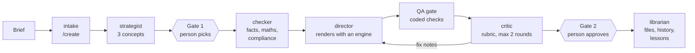
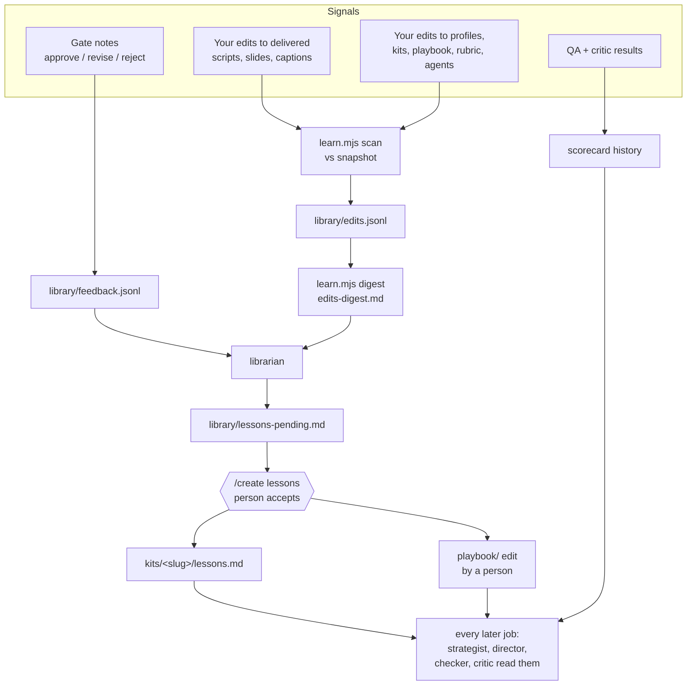

# Studio architecture

How Studio runs, where every piece of state lives, how it learns, and why it behaves the same on every laptop.

## 1. The pipeline

- **Agents** (`.claude/agents/*.md`): strategist, director and critic run on Opus (creative work). The checker runs on Sonnet and the librarian on Haiku. At most 2 run at once, and one production at a time.
- **Job state** lives only in `jobs/<id>/job.json` and only changes through `node studio/tools/job.mjs`, so the Desk's live flow graph is always exact.
- **Engines** are chosen per piece by the strategist. The director follows the engine's adapter in `studio/engines/<engine>.md` literally:

| Engine | Adapter | Engine folder | Makes |
|---|---|---|---|
| films | `films.md` | `engines/films` | Graphic reels in 98 code-made film styles |
| stills | `stills.md` | `engines/stills` | Carousels, statics, covers, stories |
| motion | `motion.md` | `engines/motion` | Short hooks, GIFs |
| custom-html | `custom-html.md` | (job-local) | One-off hand-built carousels |
| hyperframes | `hyperframes.md` | npm `hyperframes` | HTML-to-video reels |
| face-reels | `face-reels.md` | `engines/face-reels` | Reels from client footage |

- **Shadow copies.** Engines are read-only. The director copies what it needs into `jobs/<id>/project/` (`studio/engines/bin/shadow.sh`) and renders there, so one job's tweak never leaks into another.
- **QA gate** (`studio/tools/qa/gate.py`): loudness, frame and caption checks, OCR margins, banned phrases, near-duplicate check against the library, compliance line. The critic then scores the piece against `studio/rubric/critic.md`.

## 2. Where things live

| Kind | Path | Repo | Who writes it |
|---|---|---|---|
| The bot, agents, skills, guard | `.claude/` | studio (public) | people |
| Machinery, adapters, rubric, evals code | `studio/` | studio | people |
| Engines | `engines/` | studio | people (read-only for the bot) |
| House rules | `playbook/` | studio | people (the bot proposes edits) |
| Client facts and images | `private/clients.json`, `private/assets/` | studio-clients (private) | people (read-only for the bot, except `profile.md`) |
| Client kits and approved lessons | `private/kits/<slug>/` | studio-clients | bot and people |
| Standing brief per client | `private/assets/<slug>/profile.md` | studio-clients | people |
| Past work, feedback, edits, pending lessons | `private/library/` | studio-clients | bot |
| Job track record (text) | `private/jobs/<id>/` | studio-clients | bot |
| Eval briefs, reviews, scorecard history | `private/evals/` | studio-clients | bot and people |
| Keys | `studio/.env` | neither (gitignored) | people |
| Radar data | `radar/` | neither (regenerable) | bot |

`studio/tools/link_data.sh` links `kits`, `assets`, `library`, `jobs`, `clients.*` and the eval data from `private/` into the places the code expects. Without a private repo it creates `private/` from `examples/`.

## 3. How Studio learns

Everything Studio learns is a file in the repos, so it travels with `git pull`. Claude's own memory stays on one laptop and is never relied on.

- **Snapshots.** When the director or critic finishes, `job.mjs` fingerprints what the bot made (`jobs/<id>/.snapshot.json`).
- **Edits.** `learn.mjs scan` compares each job with its snapshot. It records your changes (field-level for JSON scripts, line-level for text, file swaps for media) and the knowledge files you changed in either repo, committed or not, in `library/edits.jsonl`. It runs on `/create resume`, `/create learn` and in every librarian pass.
- **Lessons.** The librarian turns repeated or preference-stating edits and notes into proposed lessons with evidence. You accept them, and they land in `kits/<slug>/lessons.md` (per client) or as a playbook edit you make yourself.
- **Use.** Every agent reads, in order: `assets/<slug>/profile.md` (standing brief), `kits/<slug>/` (facts, voice, lessons, history), `playbook/`. Variety checks read the library and client history, so no two pieces repeat a device.
- **Measurement.** `studio/evals/scorecard.py` scores 68 tests across 8 suites (radar, intel, kits, creative, library, pipeline, intake, golden) into `studio/evals/history/`. The Desk shows the trend, so you can see whether changes made things better.

## 4. Same result on every laptop

| What | Pinned by |
|---|---|
| Node | `.nvmrc` (25) |
| Python | `.python-version` (3.12, installed by `uv`) |
| Python packages | `studio/requirements.txt` (exact versions), `engines/films/requirements*.txt` |
| npm packages | `package-lock.json` in `studio/lib`, `engines/films`, `engines/stills`, `engines/motion` (`npm ci`) |
| Headless browser | `playwright-core` version in the lockfiles (it installs its matching Chromium) |
| System tools | `Brewfile` |
| Fonts | bundled in the engines (with their licences) |
| Voice and music | the Kokoro model and sample packs fetched by `engines/films/setup.sh` from fixed release URLs |
| Agent behaviour | `.claude/` (agents, skills, hooks, settings) committed; models chosen in each agent's frontmatter |
| Render output | the film and still engines are deterministic: every frame is a function of time and a seed |

`sh setup.sh` installs all of it. `sh studio/tools/doctor.sh` proves it, and fails loudly on any mismatch.

## 5. Safety

- **Guard hook** (`.claude/hooks/guard.mjs`, runs before every write or shell command):
  - It blocks posting or publishing to Instagram or Facebook.
  - It blocks writes into `engines/`, `playbook/`, `assets/` and `clients.*`. The exceptions are `assets/<slug>/profile.md` and the face-reels inbox and reels folders.
  - It blocks `rm` or `mv` on those paths.
- **Data routes:** official APIs (YouTube Data API, Instagram Business Discovery), RSS and manual entries only. No scraping of social sites.
- **Facts:** checked against the kit and its sources. Anything missing stays a visible TODO, and Ontario pieces without a licence line are PROOF only.

## 6. Running it every night (optional)

On the laptop that owns the radar, schedule `node studio/radar/clients.mjs && node studio/radar/run.mjs && studio/.venv/bin/python studio/evals/scorecard.py --quiet`. Use cron, launchd, or a Claude Code scheduled task. It refreshes competitor posts and the scorecard. It never posts.
